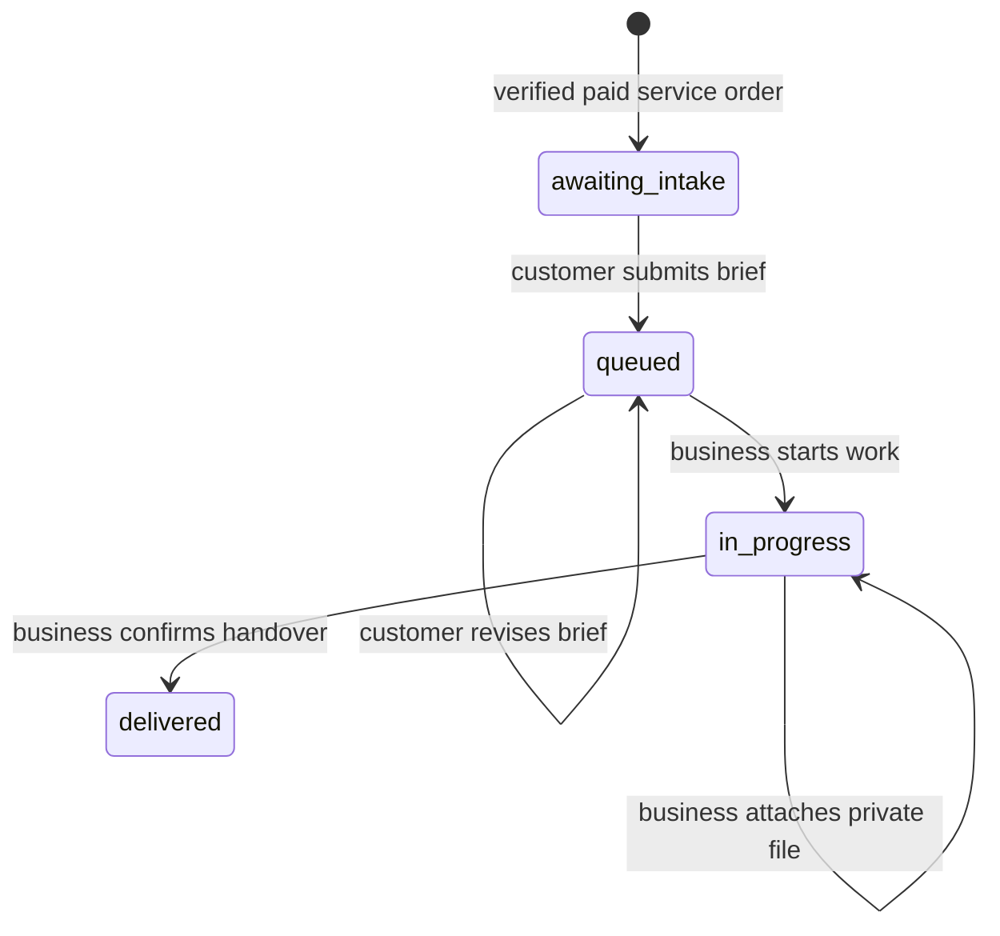

# Customer purchases and business fulfilment

This release extends the existing CQA marketplace. It does not replace the
GitHub design or create another application/repository.

## Customer journey

1. The customer signs in or creates an email-confirmed Supabase account.
2. The machine's purchase button attaches the current bearer session. The server
   verifies that account and the available offer, payment configuration and
   connected business account.
3. Checkout persists a pending purchase contract before returning the Stripe URL.
   The verified account ID is separate from the payer-editable Stripe email.
4. Only the signature-verified Connect webhook settles the order and grants paid
   access. Duplicate events and refunds retain the existing protections.
5. `/account` shows purchases belonging to that customer. Digital purchases use
   the existing private library; services open a project brief and order timeline.
6. A submitted service brief enters the owner's queue. The owner starts work,
   optionally attaches a private file, and confirms delivery with a handover.
7. Customers see the delivery in their account. A download request verifies the
   account, order, current paid status and private file scope again before signing.



These are fulfilment states, not payment states. A refunded, cancelled or disputed
payment cannot create another fulfilment transition or obtain a new private link.
Order history retains the purchaser ID independently of revoked access. Old
email-only purchases are not automatically claimed by a new account.

## Surfaces

| Surface | Purpose |
| --- | --- |
| `/account` | Customer order history, filters and pagination |
| `/account/orders/[orderId]` | Brief, progress, timeline and private delivery |
| `/owner/orders` | Business fulfilment queue and delivery actions |
| `/api/customer/orders` | Verified customer-owned history |
| `/api/customer/orders/[orderId]` | Scoped order detail and timeline |
| `/api/customer/orders/[orderId]/intake` | Revision-checked service brief |
| `/api/customer/orders/[orderId]/download` | Entitled private service delivery |
| `/api/customer/orders/[orderId]/billing` | Connected-account Stripe subscription management |
| `/api/owner/orders` | Verified business-owner queue |
| `/api/owner/orders/[orderId]` | Business detail, start and deliver actions |
| `/api/owner/orders/[orderId]/asset` | Bounded private deliverable upload |

The existing `/marketplace/library` and its private digital-download APIs remain
the digital-product fulfilment path. A digital purchase never enters the service
intake/start-work workflow. The existing owner dashboard still manages the
business's platform subscription and Stripe Connect onboarding.

## Database rollout

The new schema is in
`supabase/migrations/20261117113349_customer_fulfillment.sql`. It requires the
existing CQA marketplace tables and buyer-entitlement columns; it is not a
replacement baseline for a blank Supabase project.

The migration backfills `customer_user_id` only from existing `buyer_user_id`
values. It adds a server-authored purchase snapshot so later catalogue edits do
not change a new customer's recorded title or purchase type. It creates private
order workspaces and content-free timeline events.
Business owners may read their rows through RLS, but browser roles cannot mutate
fulfilment or call the server-only transition function. The server verifies the
Supabase user before calling that function. Each transition locks the paid order
and checks the expected revision; the event and state update commit together.

Subscription management is authorized from the durable order and the original
connected-account Stripe Checkout/Subscription metadata. It does not depend on
the offer remaining in the catalogue and does not grant delivery access. The
connected business must configure its Stripe customer portal before customers
can use that provider-hosted screen.

The intended first remote target is the existing isolated **CQA Launch Test**
project, `ndzmlywsuywkhgqdbzft`. An application attempt was rejected by automatic
approval review because explicit permission for changing that project's existing
data had not been given. No remote schema or order data was changed. Approve this
specific migration before applying it there. Production requires a separate
rollout after integration verification.

## Service configuration and verification

Use the isolated Supabase URL/public key/server key, Stripe sandbox and Connect
webhook credentials, private R2 bucket and server credentials, and transactional
email configuration. Follow `.env.preview.example` and
`docs/commerce-launch-verification.md`; do not weaken release holds or reuse
production secrets as test fixtures.

- `node scripts/cqa-engineer/checks.mjs` runs all repository regression checks,
  types, lint and the compilation build.
- `tests/customer-fulfillment-database-check.mjs` executes the actual migration
  and transitions in a local in-memory PostgreSQL engine. It makes no remote
  database changes and deliberately gives `service_role` no `auth.users` read.
- Customer/owner API checks cover identity, tenant boundaries, file validation,
  revision conflicts, refund races and safe response shapes.
- Portal-state checks exercise actual rendering and stale-session responses.
- Browser checks with intercepted QA fixtures establish UI behaviour only. They
  do not establish that Stripe, Supabase Auth, email or R2 are connected live.

To repeat browser QA, install Chromium with `npx playwright install chromium`,
start a dedicated local development server using the non-credential fixture
configuration below, then run `npm run test:customer-ui` in another terminal:

```bash
NEXT_PUBLIC_SITE_URL=http://localhost:3100 \
NEXTAUTH_URL=http://localhost:3100 \
NEXT_PUBLIC_SUPABASE_URL=https://portal-qa-fixture.supabase.co \
NEXT_PUBLIC_SUPABASE_PUBLISHABLE_KEY=sb_publishable_browser_qa_fixture \
npm run dev -- --hostname 127.0.0.1 --port 3100
```

This configuration is only for the intercepted UI test. It cannot authenticate
real users and must never be used for a deployment. The runner permits local
HTTP URLs only and blocks external requests. If Chromium is installed by the
host instead of Playwright, set `CQA_UI_BROWSER_EXECUTABLE` to its executable.
Screenshots are written under ignored `work/customer-portal-ui/`. Do not run a
Next.js build against the same output directory while this server is running.

After the isolated migration and environment are approved/configured, verify a
real account confirmation, isolated Stripe checkout, signed webhook, customer
brief, owner delivery, private download, refund and loss of access with distinct
owner and buyer accounts. Existing compilation fixtures must never be treated as
that evidence or deployed as provider configuration.
